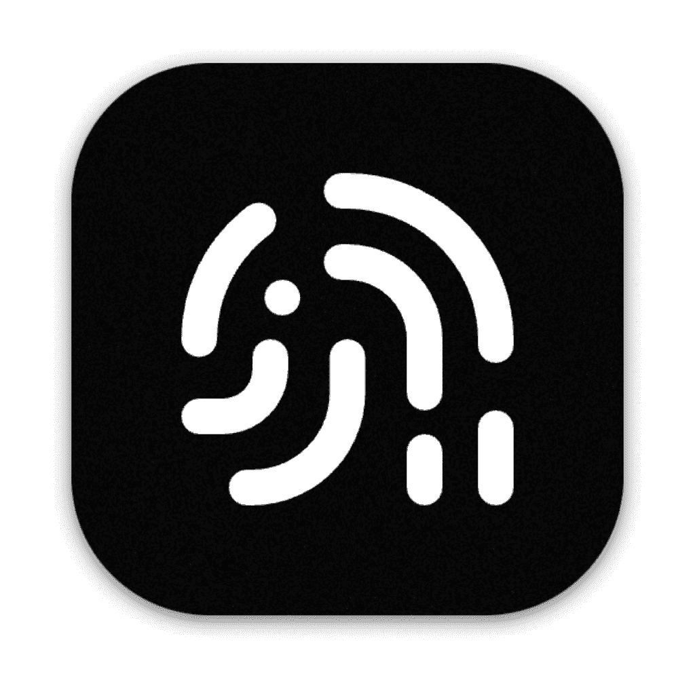
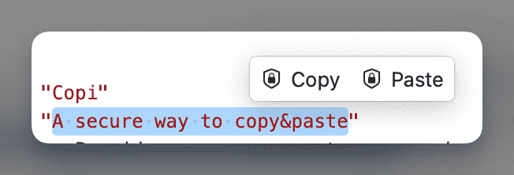
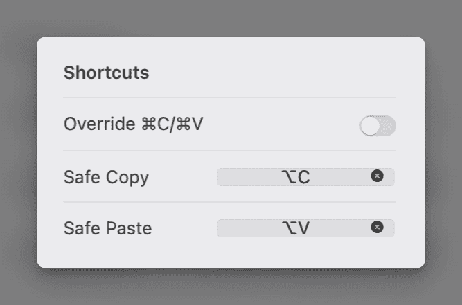
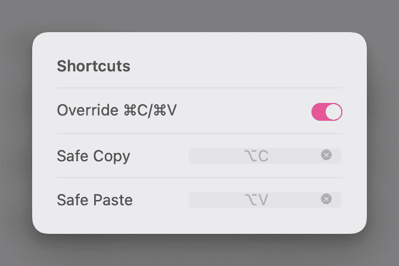
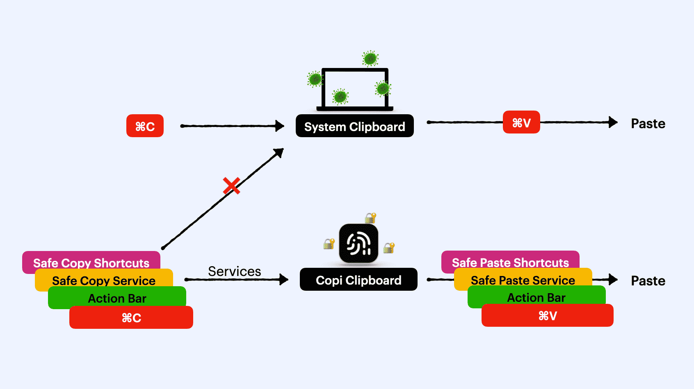
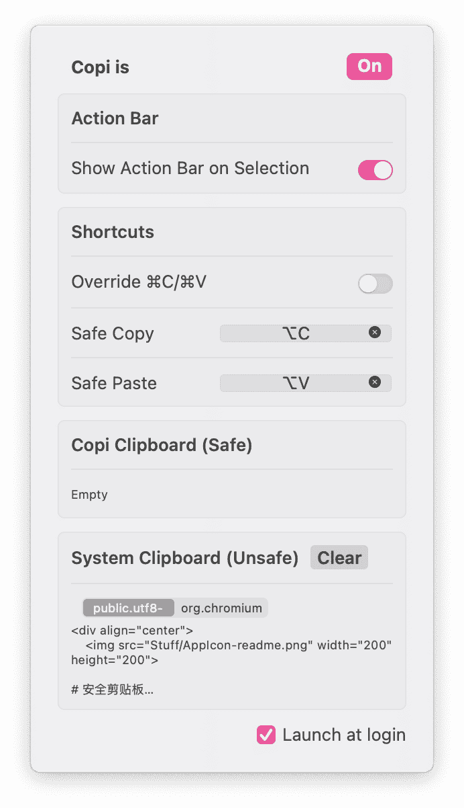

<div align="center">
    

# Copi
**A Secure Alternative to the Mac System Clipboard**

**English** · [简体中文](./README.zh-CN.md)

<!-- SHIELD GROUP -->
[]() []() [](https://www.gitfish.dev/repo/s1ntoneli/Copi)

</div>

[Copi](https://copi.cleanclip.cc) is an open-source, lightweight, and secure clipboard alternative for macOS. It takes over copying and pasting text, keeping what you copy where no other application can read it, effectively protecting your privacy data. It carries plain text only (formatting is dropped).

## Download
https://github.com/s1ntoneli/Copi/releases


## Why Copi?

1. Defend against clipboard hijacking attacks
2. Prevent clipboard content leakage

## Who Needs It?

If you:
1. Own digital currencies
2. Frequently copy sensitive information
3. Don't trust the system clipboard

## How to Use?

### 1. Action Bar Mode
Once the Action Bar is enabled, when you select text, quick buttons for secure copying and pasting will appear above the selected text. Click with the mouse to use Copi's clipboard for text operations. Long-press (or drag in) the text field you're typing in to show the paste option; Paste only goes into that field, and the bar closes if another app comes to the front.



### 2. Shortcut Mode
You can set dedicated shortcuts for secure copying and pasting. They work while "Override ⌘C/⌘V" (below) is off.



### 3. Override System Copy and Paste Shortcuts
On by default. ⌘C, ⌘X and ⌘V go through Copi's secure channels. They carry plain text only: formatting is dropped, and copying app objects (a mail message, a shape, an image in a text document) takes a second ⌘C (see below) unless the app is in **Apps Using the Normal Clipboard**; files in Finder's file list and an image that has the focus itself (not one inside text) copy on the first ⌘C, unless Live Text in it is selected. What such a copy puts on the clipboard is then kept by Copi, like text (see below). ⇧⌘V and ⌥⇧⌘V paste Copi's text where the app's own menus use them for a Paste variant; in browsers ⇧⌘V does too (a web app's paste without formatting), unless a clipboard manager that opens its history with ⇧⌘V (Paste, Pastebot, Flycut, Clipy, CleanClip) is running. Elsewhere these keys go to the app or to whatever program uses them. In Copi's own windows ⌘C/⌘V work as usual. If you turn it off, ⌘C/⌘V use the system clipboard as usual and only the Action Bar and the Safe Copy/Paste shortcuts are protected.



## Why Trust You?
Open source.

## How to Ensure Data Security?

Copi keeps copied text in its own memory (never in a pasteboard other apps can read) and, by default, **never puts it on the system clipboard** — so other apps, clipboard managers, Universal Clipboard and Spotlight's clipboard history can't see it. It moves text in and out of apps directly:

- **Native text fields**: reads and writes the selection through Accessibility. With several selections (⌘-drag), copies them all. If the app changes the pasted text as it inserts it (for example auto-indent or smart quotes), Copi leaves it in place and tells you to check it.
- **Safari / web views**: inserts through WebKit's text-editing accessibility API; reads page selections through text markers.
- **Chrome-based browsers and Electron apps**: writes plain inputs through Accessibility and reads selections through text markers (needs "Accessibility for Chrome & Electron Apps", on by default; Copi only asks these apps to build their accessibility tree and never turns on their screen-reader mode).
- **Password fields, single-line fields and rich-text editors (Slack, Notion, Gmail…)**: types the text, like a password manager's auto-type. Multi-line text is typed (line breaks as ⇧↩) only in native (AppKit) text views and in known chat, mail and code-hosting apps and sites where ⇧↩ is a line break (in other toolkits ⇧↩ can mean something else: in Jupyter QtConsole and Spyder it runs the code; in Java apps it inserts nothing, so there multi-line text goes into text areas only through Accessibility, never typed); in Google Sheets cells line breaks are typed as ⌘↩; in single-line fields, such as search boxes and password fields, line breaks become spaces, as when a browser pastes into them; elsewhere (notebooks) only single lines are typed. Rich-text editors turn some typed text into formatting that a real paste keeps as it is (a line starting with "- ", "# ", "> " or "1. " becomes a list, heading or quote; :smile: becomes an emoji), so text like that isn't typed into them; Copi offers to paste it through the clipboard instead. A :name: glued to letters, digits or colons on both sides, as in `arn:aws:s3:::bucket`, an IPv6 address or `std::io::Write`, doesn't count.
- **Input methods (Pinyin, Japanese, Korean…)**: while it types, Copi switches to ABC (or U.S.) and switches back afterwards, using the system's input-source shortcuts so the app really goes back to your input method. It never switches while you are still composing (Chrome-based browsers and Electron apps don't report composing, so finish composing there before pasting). Turn off **Switch to ABC While Typing** to switch yourself instead.
- **VS Code, Cursor, Windsurf, VSCodium and other VS Code-based editors**: install **Copi Bridge** from **Editor Bridge** in Copi's menu (if the editor's row says **Outdated**, click **Reinstall**, then restart the editor). Copy, cut and paste in the editor, paste in the commit message box and chat input, and copy and paste in the integrated terminal then go through the editor's own commands, so multi-cursor, whole-line copy and formatting work as usual, with no clipboard. Without the bridge, only single-line text made of letters, digits and simple symbols is typed.
- **JetBrains IDEs**: in the file editor, pastes any text through Accessibility (one undoable edit), copies the selection or, with nothing selected, the whole line, and cuts selections. In the IDE's terminal, types single lines when every terminal is at a shell prompt.
- **Terminals**: in **iTerm2** and **Ghostty** (after you allow Copi under **Terminal Access** in its menu), in **WezTerm** (no setup needed) and in **kitty** (after you turn on its remote control, see below), the text goes straight to the terminal through the terminal's own interface (except single lines for a program reading a whole line, which are typed, see below): no keystrokes for other apps to see, no input-method switching, and multi-line text arrives as a bracketed paste (inserted, not run) in zsh, bash 4.4+ (5.1+ in Ghostty, WezTerm and kitty) and fish. When that interface can't be used for a paste (Ghostty's Quick Terminal or an older Ghostty, WezTerm's copy mode, kitty older than 0.32.2 or without its socket, a window Copi can't match), Copi types the text as in other terminals. While WezTerm's copy mode is open (its window title starts with "Copy mode:"), letters there are commands (y copies and closes it), so Copi types nothing; the second press lets WezTerm paste into its search itself. When Copi can't read the window title, it types single lines as plain keys and refuses multi-line text: a bracketed paste starts with an Esc key, which would close an open search and send the rest to the shell. In Ghostty, WezTerm and kitty, single lines also work inside Vim, but not while Vim or Neovim is running a program in one of its own terminal windows (`:terminal`, focused or not), since the text could go to that program, where letters may be commands. When Neovim is in front, Copi pastes any text through Neovim's own RPC socket instead, the way a real paste arrives (inserted in Insert mode, put before the cursor in Normal mode), with nothing typed and nothing on the clipboard: in Terminal and iTerm2 when the window title shows nvim as the running program (not as the folder) and only one tab runs it, in other terminals when they have a single tab; not while Neovim waits for a key or one of its own terminal windows has the focus, or while WezTerm's copy mode or search is open over it. This needs Neovim to listen on exactly one socket; with none or several (a config that starts another server, Neovim run with sudo), the paste takes the terminal's usual route. In other terminals Copi types at a shell prompt (or a `sudo` password prompt, which Copi confirms from the terminal's settings: a `sudo` already running a command is not a prompt), judged from the terminal's processes; multi-line text is typed as a bracketed paste in zsh and bash 4.4+ (Terminal, iTerm2, Ghostty, kitty, WezTerm, Alacritty). Copi can't see which tab is focused there, so every tab's shell must allow it; in Terminal and iTerm2, when the window title names the focused tab's shell, only the tabs running that shell count, unless a tab that isn't at its prompt also runs a program by that name (in iTerm2, such as a zsh script). Multi-line text is only sent while the shell is waiting for a command (not to a script's `read` prompt), and shells using vi key bindings get bracketed pastes only. Where fish can't take a typed bracketed paste and has abbreviations, a line with a space or ; | & isn't typed, since typing would expand them. Nothing is pasted while a terminal waits for a single key (such as zsh's `read -q` or bash's `read -n 1`), not even with **Allow Clipboard Fallback**, since the first character would answer it. If **tmux** is in front (in any terminal except Alacritty), Copi hands the text to tmux itself, which pastes it into the current pane like a real paste (bracketed when the program there asked for it); the same prompt rules apply to what runs inside the pane. Inside tmux, programs other than a shell (such as Vim, with the same rule for its terminal windows) get text only with tmux 3.7 or later, which tells Copi whether the program turned on bracketed paste. Neovim in a tmux pane that listens on a single socket gets any text through it, with any tmux version. This works when Copi can tell which terminal tab is focused (iTerm2, Ghostty and WezTerm with the routes above; in Terminal and iTerm2 when the window title shows tmux, only one tab runs tmux, and the title names no other tab's program; in other terminals only with a single window, a single tab and no splits) and needs tmux 3.1 or later. The text reaches tmux through a pipe, never as part of a command, so it doesn't end up in tmux's message log (`tmux show-messages`), and its buffer is deleted right after the paste. Copi doesn't use tmux's paste buffer when any session has hooks that run on it (such as `after-load-buffer` or `after-paste-buffer`), since they could save the text somewhere. (Copi builds before this one passed the text as a command argument, which tmux kept in its message log until the tmux server restarts; restart tmux if you pasted secrets with them.) When the program in front is reading a whole line (a script's `read`, also in a script that another script started, Python's `input()`, an ssh or gpg password prompt, also a `sudo` or ssh password prompt that a script started, as in Homebrew's installer), single lines are typed into it: the terminal edits that line itself, so letters can't act as commands, and nothing happens until you press Return. This also applies in iTerm2, Ghostty, WezTerm and kitty when their own interface finds such a program in front. iTerm2, WezTerm and Ghostty releases after 1.3 tell Copi which session is focused, and the keys go only there, so only that session counts: Vim, less or ssh in another tab, or a shell there waiting for a single key or using vi key bindings, doesn't stop it. In kitty and Ghostty 1.3, as in the terminals Copi types into, every tab must be at a shell prompt or have a program reading a line. Copi judges this from the terminal's settings, since macOS doesn't show whether a program is really reading: a busy program that isn't a shell script (such as `sleep`) gets the line as typeahead, as with a real paste; a program that runs its commands through `sh -c`, such as `make` running a recipe with `&&`, counts as a shell script waiting for a program it started. Otherwise, if less, an ssh session, a shell running a script that is waiting for a program it started or reads its script from standard input (such as `bash install.sh` while it downloads, `curl … | bash` or `bash < install.sh`: the script could read the pasted text later as its input) or anything Copi can't identify is running, it refuses, as it does for WezTerm panes in an ssh or tmux domain. Copi tells whether zsh, bash, sh, dash, ksh, csh, tcsh or fish is at its prompt or running a script from the shell's startup arguments and from whether the shell reads its input from the terminal; when such a shell belongs to another user (such as a root shell opened with `su`), Copi can't check either and refuses too. It also refuses in iTerm2's tmux integration (`tmux -CC`): there iTerm2 sends whatever is pasted or typed to tmux as commands, which tmux keeps in its message log, and the session running `tmux -CC` reads text as tmux commands. Copi never hands text to a tmux client in control mode (`-C`) in any terminal. With Terminal Access, Copi asks iTerm2 whether the focused session belongs to the integration; without it (or when iTerm2 can't say), Copi refuses in every iTerm2 session while a `tmux -CC` started on this Mac is running, and it can't see one started over ssh. Wherever the text would reach a prompt that reads a whole line without a line editor, such as a `sudo` password prompt or a script's `read`, Copi refuses lines longer than 1000 bytes, whether it types them or hands them to the terminal or to tmux: the terminal keeps only 1024 bytes of such a line and silently drops the rest, Return included. Characters outside ASCII (accented letters, curly quotes, Chinese, emoji) take 2 to 4 bytes each. A search field or composer in the terminal window gets single lines typed into it; iTerm2's Composer also takes multi-line text, written into it directly, and nothing runs until you send it.
- **Web code editors (Monaco, CodeMirror…)**: types single-line text made of letters, digits and simple symbols (API keys and tokens usually are); anything that would trigger auto-closing brackets or completions is refused, as is any editor in Vim mode.
- **Firefox**: writes text fields through Accessibility, types into the editors of known chat and mail sites, and copies page text paragraph by paragraph. A web terminal or code editor it can't recognize there (they take keys through a hidden input box) gets nothing on the first ⌘V; the second press goes through the page's own paste, so a terminal never runs a pasted line early. Firefox doesn't say how many pieces are selected, so with Override ⌘C/⌘V on, after you add a selection with ⌘ (⌘-drag or ⌘-click), the first ⌘C or ⌘X in that page or field copies nothing, even with **Allow Clipboard Fallback**, until you click its text again; pressing it again within 8 seconds lets Firefox copy every piece itself, and Copi moves the text off the clipboard within milliseconds. With Override ⌘C/⌘V off, Copi doesn't keep track of this, so the copy shortcut and the Action Bar may copy only the first piece.
- **Virtual machines and remote desktops**: presses the real keys for single-line text (characters on your keyboard layout; Caps Lock must be off). Each key takes a few hundredths of a second, so long text takes a while; Copi shows its progress. The guest must use the same keyboard layout as this Mac: Copi presses the keys that type each character on the Mac's layout, so with a different layout the guest may get other characters (with U.S. on the Mac and German in the guest, y comes out as z). Copi can't see what is running in the guest (in vim or less, letters are commands), so this is off until you turn on **Type Into Virtual Machines**. Pasting there through the clipboard (with **Allow Clipboard Fallback**) would leave the text on the guest's clipboard, and in its clipboard history, after the paste, so Copi asks first: paste again within 8 seconds to paste anyway (holding ⌘V down doesn't count). ⌘C and ⌘X in the guest's window go to the guest, which copies with its own clipboard, as Ctrl+C in Windows would. If the app shares that clipboard with this Mac, the text lands on the Mac's clipboard and Copi moves it in within milliseconds (a program watching the Mac's clipboard could see it during that time). ⌘V in the same guest then pastes from the guest's own clipboard (also when the guest copied an image or files, or Copi keeps an older image), unless you have copied something newer on the Mac. Copy-refusal notices in these apps' own windows don't offer the normal-clipboard button, since the app can share the clipboard with the guest. This covers Parallels, VMware, UTM, VirtualBox, VirtualBuddy, Microsoft Remote Desktop / Windows App, Screen Sharing, Citrix, Horizon, RealVNC, TeamViewer, AnyDesk, Jump Desktop, Parsec, RustDesk, Moonlight, Amazon WorkSpaces, Royal TSX, Screens, the iOS Simulator and iPhone Mirroring.
- **⌘X**: in editable fields Copi reads the selection, keeps it, and then deletes it. Where it can read but not delete, it copies and tells you. Keys you press right after ⌘X reach the app as usual, except a Return pressed before the text is deleted (also ⌘↩ with ⌘ still down from ⌘X), which Copi holds back and doesn't send, so a chat app doesn't send the message; if any key, Return included, comes before the delete, Copi leaves the text in place and tells you (and that the Return wasn't sent, so you can check the field before sending).

Where nothing works without the clipboard (for example the Google Docs, Sheets and Slides editors, which draw their text themselves and auto-correct typing; other pages on docs.google.com, such as forms and published documents, work like any web page), the first ⌘V pastes nothing and Copi tells you why, in a small panel at the bottom of the screen as well as in a notification; press ⌘V again, at least 0.6 seconds later and within 8 seconds, to paste through the clipboard instead, the same way as with **Allow Clipboard Fallback** below. With Override ⌘C/⌘V off, press the Safe Paste shortcut again or click Paste in the Action Bar again instead, as the notice says: ⌘V then uses the system clipboard as usual. A key held down or a quick double press doesn't count, and Copi takes a press as yours only if the keyboard registered a key at that moment: a ⌘V another program sends while you aren't typing doesn't count, but one it sends right as you type, or through the system's keyboard input as some key remappers and macro tools do, does. Copy or Paste chosen in a menu, the Safe Paste shortcut and the Action Bar's Paste count only when the mouse or keyboard registered your click or key at that moment too. The same goes for Copi's other "paste again" questions. This is what "refuses" means throughout this README, except where a paste through the clipboard wouldn't help either: a line too long for the prompt it goes to, a shell waiting for a single key, **Don't Type When Keystrokes Are Watched**, and a paste while Copi is still typing the previous one. Copying works the same way: where Copi can't read a selection, the first ⌘C (or ⌘X) copies nothing and tells you why, and pressing it again within 8 seconds lets the app copy it itself, after which Copi moves the text off the clipboard within milliseconds. This also applies where Copi sees no selected text (some editors then copy the whole line). It isn't offered when macOS doesn't let Copi read the clipboard (**Paste from Other Apps**), and for ⌘X not while macOS asks first either, since the text would wait on the clipboard for your answer while it is already cut from the document. When macOS asks first, text copied this way waits on the clipboard, unmarked, until you answer; if you don't allow it, Copi removes it and nothing is copied. While a virtual machine, remote desktop or simulator that shares the clipboard is running, the notice names it, since it could copy the text to its own clipboard, where it stays; if one starts after the notice, Copi asks again. Where it pastes by typing, it also refuses text with tabs or other control characters besides line breaks; only text typed into a terminal as a bracketed paste may contain tabs. There is no length limit: when typing will take more than a moment, a small panel at the bottom of the screen shows how far Copi has got, and Esc stops it. You can:

- add an app to **Apps Using the Normal Clipboard** (or click the button on a copy-refusal notification; virtual machines and remote desktops don't get one): text copied in that app stays on the system clipboard as usual. Only that app's own copies do; text you copied elsewhere is still pasted into it without the clipboard, and anything other programs put on the clipboard while it is in front is still moved into Copi. A copy counts as that app's own when it is the first one within 2 seconds after a ⌘C/⌘X Copi let through to it or follows that one within 0.3 seconds, or when it follows within a second a click in one of its windows, a copy or cut shortcut like ⌃C, ⌃X, ⇧⌘C or ⇧Delete, Copy or Cut chosen in its menus, or Return in a terminal or password manager; a copy marked as a password counts only after a ⌘C/⌘X Copi let through, or when the app declares it wrote it; in a password manager, the other cases above count too. Or
- turn on **Allow Clipboard Fallback (Less Secure)**, which skips that second ⌘V and ⌘C: Copi briefly puts the text on the clipboard instead (marked so clipboard managers don't record it, not synced to your other devices, and removed within about a second after the app reads it, or after 3 seconds if nothing does; a program watching the clipboard can read it during that time). For copies Copi can't read directly, the app copies as usual: the text sits on the system clipboard, unmarked (clipboard managers, Spotlight's clipboard history, Handoff and virtual machines' clipboard sharing may see it), for the few milliseconds until Copi moves it off (or, if macOS asks whether Copi may read it, until you answer; if you don't allow it, it stays there). Virtual machines, remote desktops and simulators running on this Mac can still copy it to their own clipboard, so while one of them is running Copi asks first and names it: paste again within 8 seconds to go ahead. If another one starts after the notice or after you confirmed, Copi asks again and names it.

**kitty**: its remote control is off by default. Click **Set Up…** next to kitty under **Terminal Access**: Copi puts a small check script (`copi_rc_auth.py`) in kitty's config folder and shows three lines to add to `kitty.conf`:

```
allow_remote_control password
remote_control_password "" copi_rc_auth.py
listen_on unix:kitty-copi
```

Restart kitty afterwards. Without a password, the script only lets apps on this Mac send text to the focused kitty window through the socket: nothing can read from kitty this way, and programs running inside kitty (including over ssh) can't use it without a password. That is, programs that reach kitty through the terminal itself (escape codes, including over ssh) can't use it; any program running as you on this Mac, including ones running inside kitty, can still send text to the focused kitty window, and a request carrying a password kitty doesn't know makes kitty ask you whether to allow it (Copi never sends one, so say no). Leave it off if that worries you.

Other protections:

- Copi's clipboard is hidden in the menu until you click **Show**, and is cleared when the Mac locks or sleeps. **Clear Copi Clipboard After** can also clear it 1, 5, 15 or 60 minutes after you copy.
- **Copy, Cut and Paste in menus and right-click menus** go through Copi too: it catches the click, or the Return key when you choose them with the arrow keys, before the menu item runs, closes the menu and handles it like ⌘C/⌘X/⌘V. Copi learns each app's own names for these items (for example 复制 in Chinese apps) as soon as the app comes to the front. Copy chosen in a right-click menu on something other than the field you're typing in (a chat bubble, a list row) runs the app's own Copy, which goes through the system clipboard like a Copy button. (An app's own Copy button still goes through the system clipboard, and Copi moves the text off within milliseconds; while a menu is open Copi checks the clipboard every few milliseconds, so items chosen with Space, VoiceOver or Voice Control are moved off quickly too.)
- **Dragging selected text** would put it on the drag pasteboard, where any app can read it, so Copi stops the drag before it starts when it can tell you're dragging selected text, and otherwise clears the text from the drag pasteboard as soon as the drag starts (**Block Dragging Text**, on by default; a selection that also carries a link or picture is cleared half a second after the drop). Use ⌘X or ⌘C and then ⌘V to move text. Files and images still drag as usual. With the option off, dragged text is removed from the drag pasteboard half a second after the drop. Drags that carry text along with files or file promises (a mail message, a note) are cleared 30 seconds after the drop, giving the receiving app time to fetch the files; plain Finder file drags are left alone.
- **Find pasteboard**: ⌘E ("Use Selection for Find") and find bars put the search text on the system's find pasteboard, which any app can read. Copi notices within 20 ms (a few ms after shortcuts) and clears it 50 ms after it's written. The app you searched in keeps its own search; another app's ⌘G can't continue it. Ghostty's copy-on-select (on by default) keeps every selection in a named pasteboard any app can read; Copi clears it 10 seconds after you select (middle-click paste works within that time). GNU Emacs keeps every active region in the named pasteboards "Selection" and "Secondary" the same way; Copi clears those 10 seconds after they last change (middle-click and secondary paste work within that time). When an app empties one of these pasteboards and writes the text a while later, Copi keeps checking it every tenth of a second until it changes again.
- **Text with images**: when a copy mixes text with images or attachments, Copi keeps the text off the clipboard and drops the images (they can't be kept without the clipboard), and tells you. ⌘X on such a selection copies the text but doesn't delete it.
- With Override ⌘C/⌘V on, text that another app writes to the clipboard within 3 seconds of a protected copy, before you press a key or click, is blocked (a common clipboard-hijacking trick).
- From macOS 26.4, Terminal warns before pasting something copied in a web browser (websites trick people into pasting harmful commands). Copi pastes without the clipboard, which would skip that check, so it asks instead: the first ⌘V of text copied in a browser shows a notice, and a second ⌘V within 8 seconds pastes it.
- The system clipboard's contents in Copi's menu are hidden until you click **Show**, like Copi's own clipboard. Either one hides itself again after 30 seconds. Text Copi keeps never reaches your other Apple devices through Universal Clipboard; to paste it on your iPhone, iPad or another Mac, click **Nearby Devices** next to Copi's clipboard: Copi puts the text on the clipboard for one minute (marked so clipboard managers don't record it, kept out of Spotlight's history), and apps on this Mac can read it during that minute too. Copying works as usual during that minute; with Override ⌘C/⌘V on, a new copy takes the shared text off the clipboard. On macOS 13 and 14 Copi's menu doesn't show up in screen sharing or recordings (macOS 15 and later no longer honor that).
- While Copi is typing a paste, a key you press is held back and the typing stops: a Return would make a chat app send half the message or a shell run half the command, and other keys would land in the middle of the text. Esc stops it the same way. Typing also stops if you switch apps, click, or press a modifier key. (While Secure Input is on, for example in a password field or a terminal with Secure Keyboard Entry, macOS hides keys from Copi, so it can't hold the Return back; in terminals where the line is typed as a bracketed paste (zsh and bash 4.4+ in Terminal, iTerm2, Ghostty, kitty, WezTerm and Alacritty) the Return can't run it; in other shells, such as fish or macOS's /bin/bash, it can.) In terminals, single lines are typed as a bracketed paste where the shell supports it (not while WezTerm's copy mode or search may be open, see above), so a stray Return can't run them. If typing a bracketed paste stops after the focus has left the terminal, Copi can't end the paste there and the shell may seem stuck; Copi's notice then says to press Control-C in it. If you paste into the same field again (for one-time codes, or where Copi can't tell which field has the focus, anywhere in the same app) while Copi is still typing there, or less than 2 seconds after its typing there stopped part way (pressing ⌘ for the next ⌘V already stops it), Copi pastes nothing that time, not even through the clipboard fallback, and tells you, rather than adding the whole text after the part already typed: check the field, then paste again.
- Copi never pastes, types or copies while the screen is locked, whatever **Clear Copi Clipboard When Mac Locks** is set to.
- If you paste a password-manager copy into a browser's address bar, Spotlight, Raycast, Alfred or a search field (which may send what you type to a search service at once), Copi asks first: paste again within 8 seconds to go ahead. Web addresses paste normally.
- Copi sees keys after tools that remap them (BetterTouchTool, Hammerspoon, Keyboard Maestro), so a ⌃C or mouse button they turn into ⌘C is protected like ⌘C.
- Copies that carry only rich text, a web page fragment or a link (no plain text) are moved off the clipboard too: Copi keeps their text (formatting is dropped; for HTML it reads the tags in one quick pass, so nothing from the page is loaded and no input can stall Copi). Images and the app's own data that come with the text (many apps add a picture of what you copied) are dropped without a notice. Copied files (Finder also puts their names on the clipboard as text) and copies with no text in them, such as an image alone, are taken off the clipboard too, once the app has finished writing them (half a second after a ⌘C that Copi let through as a file or picture copy with **Allow Clipboard Fallback** off, otherwise 3.5 seconds, since some apps add text a while later; a ⌘V or ⌥⌘V before then reads it as usual, and Copi waits until that is done): Copi keeps everything they contained in memory, shows what it is in its menu, and puts it back on the clipboard only while you paste it (with ⌘V, or with the Safe Paste shortcut while Override ⌘C/⌘V is off), marked so clipboard managers don't record it, kept to this Mac, and removed about 1.5 seconds after the app last reads it (5 seconds at most). Copies over 64 MB, file promises (an app that writes the file only when you paste), and copies from your other devices stay on the clipboard as they are. Images and files copied while the screen is locked, or just before it locks, are taken off the clipboard once you unlock (Copi doesn't read them while it is locked); so with **Clear Copi Clipboard When Mac Locks** on, those copied just before locking are kept in Copi after you unlock, while text copied then is cleared. In Finder and other file managers (ForkLift, Path Finder, Marta), ⌥⌘V (**Move Item Here**) moves files Copi keeps, whether you press it or choose it in the menu. Menu items that read the clipboard themselves, such as Preview's **New from Clipboard**, work when you choose them in the menu (Copi puts the copy back first; while a virtual machine, remote desktop or simulator is running, it asks first, as ⌘V does: choose the item again, or press ⌘V, within 8 seconds), not through their shortcut; things that read the clipboard without ⌘V or a menu item (a web page's paste button, Services, Voice Control's Paste, `pbpaste`, Universal Clipboard and Universal Control on a nearby device) find it empty, as they do for text Copi keeps. Menu items that copy, capture or save something to the clipboard, or clear it (**Copy Link to Clipboard**, **Capture Area to Clipboard**, **Clear Clipboard**), run as usual: Copi doesn't put its kept image or files back for them or ask first while a virtual machine, remote desktop or simulator is running, and moves what they write off the clipboard as for any copy.
- An app sometimes writes a copy in steps (first an image or a marker, the text last), or empties the clipboard and writes the text a while later. If Copi looks in between, it keeps watching that copy until something else replaces it and moves the text once it appears: closely at first, then every tenth of a second, so text written that late can be on the clipboard for up to about a tenth of a second. Text Copi can't read at all (an app that never delivers it, or macOS's **Paste from Other Apps** set to deny Copi) is removed from the clipboard rather than left there, and Copi tells you (with **Allow Clipboard Fallback** on, it is left for the app's own paste).
- When Copi lets a ⌘C through because it looks like copying a file or picture (Finder's file list, an image) and text arrives instead, Copi moves it, tells you, and refuses ⌘C in that spot from then on (Copi's menu lists how many such spots it has learned, with a Reset button). Text shown in Finder's Quick Look or preview pane and Live Text selected in an image are never let through.
- Text copied with ⌘C inside a password manager (a revealed password, a recovery code) is kept concealed in Copi like its own Copy button's copies: hidden in the menu and cleared after 90 seconds.
- **Type Privately (Beta)**: where Copi pastes by typing, it can send the keys straight to the app instead of through the system-wide keyboard stream, so programs watching every keystroke don't see them (only ones watching that particular app do). Off by default, because some apps may ignore keys sent this way. It doesn't apply to virtual machines and remote desktops, which only take keys pressed through the system-wide keyboard stream.
- The menu bar icon shows a warning sign whenever protection is off, paused (for example after Accessibility permission was removed) or limited (macOS's **Paste from Other Apps** doesn't let Copi read other apps' copies), and Copi's menu says why, so you know even with notifications turned off.
- Copi's settings live in ordinary preferences that any program running as you can change. If one turns protection down (turns Copi off, adds an app to **Apps Using the Normal Clipboard**, allows clipboard fallback, turns on typing into virtual machines, sets Safe Paste to a key without ⌘/⌥/⌃…) and it wasn't you changing that very setting in Copi's menu, Copi tells you and shows the warning icon until you dismiss it in its menu, also when they were changed while Copi wasn't running (a program that also rewrites Copi's saved copy of its settings can hide that). If another program quits Copi, it reopens (with **Restart Copi If It Stops Unexpectedly**) and tells you which program did; if Copi stops responding (stuck, or paused by another program), it is restarted within about 20 seconds. A program running as you that is set on stopping Copi can still do it (for example by killing it and its restart helper together); if it is killed, the menu bar icon disappears and Copi tells you the next time it starts; a paused Copi keeps showing its icon, and a program that also rewrites Copi's preferences can suppress that notice.
- Command-line tools Copi runs for terminals and editors (tmux, WezTerm's `wezterm cli`, an editor's CLI) run without Copi's permissions, so a replaced tool can't use them, and Copi only talks to a WezTerm or kitty socket owned by the very process it is pasting into. In VS Code's integrated terminal, Copi Bridge only sends the text to the terminal Copi checked; if another terminal became active in between, it doesn't paste.

What Copi can't do:

- Copies an app makes by itself (a password manager's Copy button, a website's copy button, copy-on-select, `pbcopy`) reach the system clipboard first. Copi checks every 20 ms, every 4 ms after any click or shortcut, and every 3 ms all the time with **Constant Fast Check** (uses more energy), and moves them off within a few milliseconds (within about 5 ms with **Instant Clipboard Detection**, on by default, which listens for macOS's internal clipboard-change notice or, where that isn't available, keeps an invisible placeholder on the clipboard; Copi waits those few ms so a password manager can finish marking its copy). While Copi is busy handling a ⌘C or ⌘V, it keeps checking between its own steps; only a single step that waits for an unresponsive app (up to about 0.4 s), or reading a copy the source app is still producing (a large Office range), delays it. Terminals that copy every selection (iTerm2's Copy to pasteboard on selection, WezTerm's default) put text there the same way; Copi's notice says where to turn that off. Copies an app marks as passwords (most password-manager apps do), and copies made while a password manager is in front, stay concealed in Copi and are cleared after 90 seconds; copies from password-manager browser extensions or command-line tools usually aren't marked and are kept like other copies (set **Clear Copi Clipboard After** to limit how long). Text that text expanders and similar tools mark as temporary is taken off at once as well, and the tool's own paste of it goes through Copi; a temporary copy whose text has images or attachments in it stays on the clipboard for up to 3 seconds, so the tool's own paste works. Still, an app that watches the clipboard constantly could catch them in that moment; for passwords, use your password manager's autofill (for example 1Password's ⌘\ or a browser extension), which never touches the clipboard.
- macOS itself can see what passes through the clipboard: Spotlight's clipboard history (macOS 26 and later) may record a copy an app made by itself in the few milliseconds before Copi moves it, and Handoff tells your nearby devices that something was copied. **macOS Features That See the Clipboard** in Copi's menu shows whether they are on and opens their settings. Text Copi keeps never goes there, and everything Copi itself puts on the clipboard is marked to stay out of Spotlight's history.
- Software that already has Accessibility, Input Monitoring or Screen Recording permission can read text fields and keystrokes directly. Copi can't protect against it. Where Copi pastes by typing, such software sees the typed text; **Programs That Can See Keystrokes** in Copi's menu lists the ones holding keyboard event taps right now (apps that read the keyboard hardware directly or use Accessibility aren't listed; check System Settings › Privacy & Security). Turn on **Don't Type When Keystrokes Are Watched** to have Copi refuse instead of typing while a program that would see its typed keys is running (one that watches all apps at the level Copi types at, or the app you're pasting into; paused ones included; macOS's own don't count). Programs listed that only see the keyboard hardware don't stop typing, and nothing is checked while Secure Input is on, when macOS hides keys from all of them. Copi checks again before every few keys and stops if one starts watching partway (it may still see those few keys).
- Terminals and editors keep their own copies of what you paste in some cases: tmux keeps what you copy in copy-mode in its own buffers (any program that can reach tmux can read them, like the screen itself); iTerm2's Broadcast Input sends a paste to every session in the broadcast; terminals and editors with debug logging turned on may log pasted text. Copi doesn't touch these.
- Copi only protects while it runs: if it is quit, copies go to the system clipboard as usual. If it crashes or is force quit, it opens again within a couple of seconds (**Restart Copi If It Stops Unexpectedly**, on by default; use **Quit Copi** in its menu to stop it) and tells you; turn on **Launch at Login** so it also runs after you log in.



## Roadmap
- [x] Traceless copying
- [x] Action Bar
- [x] Dedicated Copy Shortcut
- [x] Override System Copy and Paste Shortcuts
- [ ] Automatic Obfuscated Paste
    - [ ] Predefined Regex
    - [ ] User-defined Regex
    - [ ] User-defined Fixed String
    - [ ] From Password Manager
- [ ] History
- [x] Cut (Command+X)

## Screenshots



## Share with More People 🔥

<div class="share">

[![][share-x-shield]][share-x-link]&nbsp;
[![][share-facebook-shield]][share-facebook-link]&nbsp;
[![][share-telegram-shield]][share-telegram-link]&nbsp;
[![][share-whatsapp-shield]][share-whatsapp-link]&nbsp;
[![][share-reddit-shield]][share-reddit-link]&nbsp;
[![][share-linkedin-shield]][share-linkedin-link]

<!-- [![][share-weibo-shield]][share-weibo-link]<br/> -->
<!-- [![][share-mastodon-shield]][share-mastodon-link]<br/> -->
</div>

## Contributing

Contributions are welcome! 👏

For major changes, please open an issue first to discuss what you would like to change.

Please make sure to update tests as appropriate.


## License

[MIT](./LICENSE)


## My Apps
* [CleanClip](https://cleanclip.cc): The cleanest clipboard manager on macOS.
* [Macaify](https://macaify.com): Fast use of ChatGPT on macOS.
* [Copi](https://copi.cleanclip.cc): A secure alternative to the Mac system clipboard.

## Star History

[](https://star-history.com/#s1ntoneli/Copi&Date)

[share-x-link]: https://twitter.com/intent/tweet?url=https%3A%2F%2Fcopi.cleanclip.cc&text=Copi%20-%20An%20open%20source%20secure%20alternatives%20to%20the%20macOS%20system%20clipboard.%20Protect%20your%20data%20a%20step%20ahead%2C%20no%20more%20worries%20about%20clipboard%20data%20leakage
[share-x-shield]: https://img.shields.io/badge/-share%20on%20x-black?labelColor=black&logo=x&logoColor=white
[share-facebook-link]: https://www.facebook.com/sharer/sharer.php?u=https%3A%2F%2Fcopi.cleanclip.cc%20Protect%20your%20data%20a%20step%20ahead%2C%20no%20more%20worries%20about%20clipboard%20data%20leakage.
[share-facebook-shield]: https://img.shields.io/badge/-share%20on%20facebook-black?labelColor=black&logo=facebook&logoColor=white
[share-linkedin-link]: http://www.linkedin.com/shareArticle?mini=true&url=https%3A%2F%2Fcopi.cleanclip.cc&title=Copi%20-%20An%20open%20source%20secure%20alternatives%20to%20the%20macOS%20system%20clipboard.%20Protect%20your%20data%20a%20step%20ahead%2C%20no%20more%20worries%20about%20clipboard%20data%20leakage
[share-linkedin-shield]: https://img.shields.io/badge/-share%20on%20linkedin-black?labelColor=black&logo=linkedin&logoColor=white

<!-- [share-mastodon-link]:
[share-mastodon-shield]: https://img.shields.io/badge/-share%20on%20mastodon-black?labelColor=black&logo=mastodon&logoColor=white&style=flat-square -->

[share-reddit-link]: http://www.reddit.com/submit?url=https%3A%2F%2Fcopi.cleanclip.cc&title=Copi%20-%20An%20open%20source%20secure%20alternatives%20to%20the%20macOS%20system%20clipboard.%20Protect%20your%20data%20a%20step%20ahead%2C%20no%20more%20worries%20about%20clipboard%20data%20leakage
[share-reddit-shield]: https://img.shields.io/badge/-share%20on%20reddit-black?labelColor=black&logo=reddit&logoColor=white
[share-telegram-link]: https://t.me/share/url?url=https://copi.cleanclip.cc&text=Copi%20-%20An%20open%20source%20secure%20alternatives%20to%20the%20macOS%20system%20clipboard.%20Protect%20your%20data%20a%20step%20ahead%2C%20no%20more%20worries%20about%20clipboard%20data%20leakage.
[share-telegram-shield]: https://img.shields.io/badge/-share%20on%20telegram-black?labelColor=black&logo=telegram&logoColor=white

<!-- [share-weibo-link]:
[share-weibo-shield]: https://img.shields.io/badge/-share%20on%20weibo-black?labelColor=black&logo=sinaweibo&logoColor=white&style=flat-square -->

[share-whatsapp-link]: https://api.whatsapp.com/send?text=https://copi.cleanclip.cc
[share-whatsapp-shield]: https://img.shields.io/badge/-share%20on%20whatsapp-black?labelColor=black&logo=whatsapp&logoColor=white


[](https://dartnode.com "Powered by DartNode - Free VPS for Open Source")
